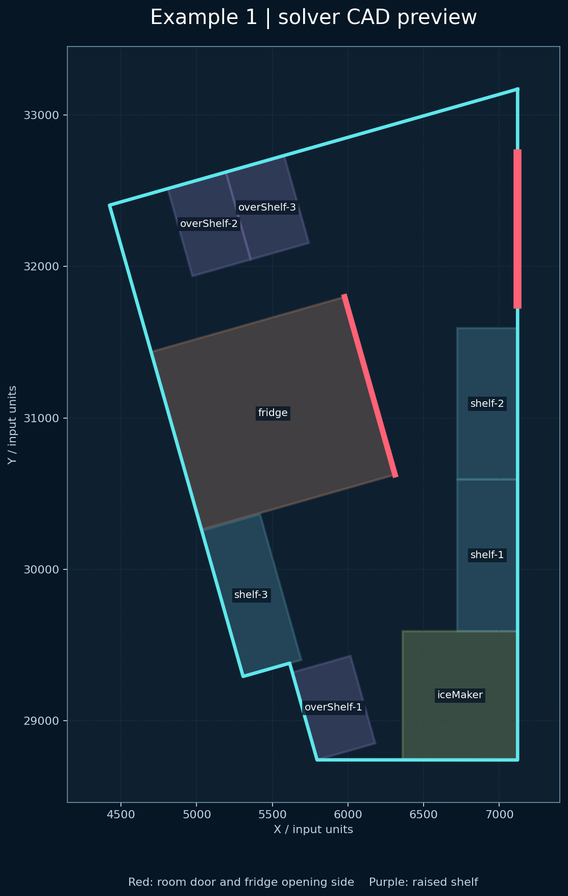
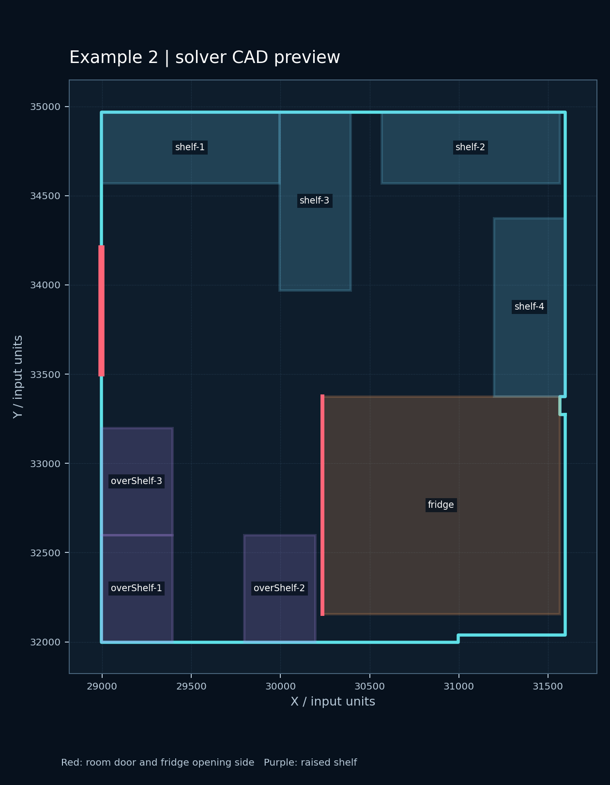
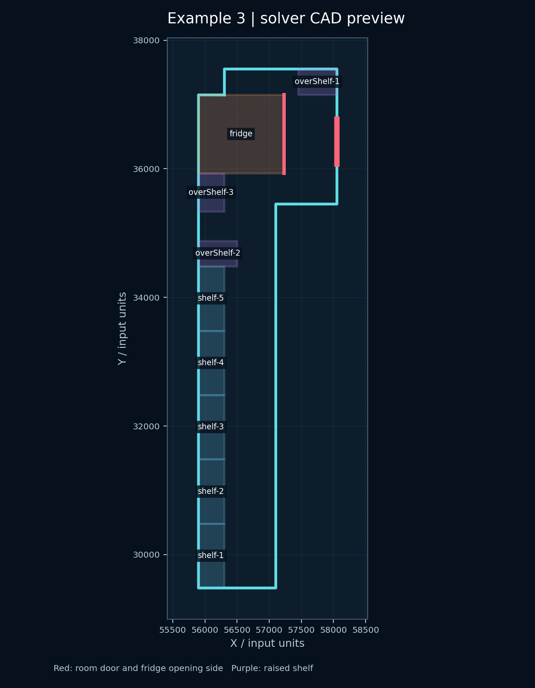
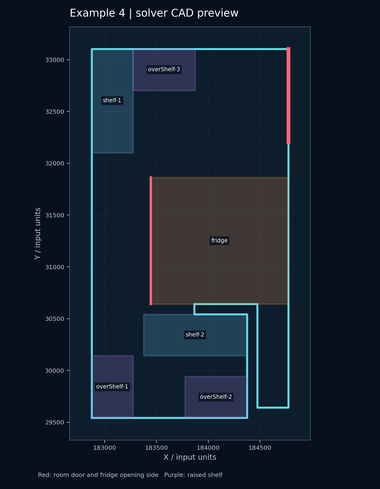

# 居灵 TakeHome工程题 - 二维多边形内矩形放置

## AI 工具使用说明

1. **使用了哪些 AI 工具**：Codex，Deepseek
2. **AI 主要帮助了哪些部分**：梳理题目要求、写代码初稿、排查运行和摆放问题，以及整理 README。
3. **自己理解并调整的关键逻辑**：

   - 贴墙候选位置与放置顺序的设计：根据墙边和已放设备的角点生成候选，优先处理冰箱等限制较多的设备，失败时回溯调整。
   - 冰箱开门边的判断：旋转后同步更新开门边，检查它是否与墙或同高度设备接触；不额外设定题目未给出的净空距离。
   - 内开门禁放区的方向判断：根据门所在墙和轮廓的顺逆时针方向，向室内构造 `N×N` 区域。
   - 架上设备的处理：只有输入明确给出高度和承托关系时才允许叠放，不根据 `iceMaker`、`overShelf` 等名称推断。

## 核心代码实现逻辑说明

### 问题定义与输入输出

`solver.py` 读取一个 JSON 对象，必需字段如下。坐标和设备长宽必须采用相同单位；四份样例使用原始 CAD 坐标，不会把房间平移到原点。

| 字段 | 含义 |
| --- | --- |
| `boundary` | 按顺序连接的房间轮廓顶点，首尾可以重复。 |
| `door` | 门洞在线段上的两个端点；门宽 `N` 为两端点距离。 |
| `isOpenInward` | `true` 为内开门，`false` 为外开门。 |
| `algoToPlace` | 物品名称到 `[length, width]` 的映射，须输出其中全部 K 件。 |

输出使用 `feasible` 和 `placements`。每件物品的 `center` 是原坐标系中的 `[x, y]`；`angleDeg` 是从 0° 起逆时针旋转的角度。0° 时，`length` 沿全局 X 轴，`width` 沿全局 Y 轴。

#### 输入与输出格式示例

输入 `boundary`、`door`、`isOpenInward` 和 `algoToPlace` 字段，例如：

```json
{
  "boundary": [[0, 0], [5000, 0], [5000, 4000], [0, 4000]],
  "door": [[0, 1000], [0, 1800]],
  "isOpenInward": true,
  "algoToPlace": {"fridge": [1220, 1330]}
}
```

尺寸和坐标须使用同一单位。题目未规定输出 JSON 的键名，本项目采用 `feasible` 表示是否可行，`placements` 按输入物品名称给出结果；每件物品只有二维中心 `center` 和角度 `angleDeg`。0° 表示物品的 `length` 方向沿全局正 X 轴，正角度为逆时针；中心点仍使用输入的原始坐标系。例如：

```json
{
  "feasible": true,
  "placements": {
    "fridge": {"center": [2000.0, 1500.0], "angleDeg": 0.0}
  }
}
```

`feasible` 为 `true` 时，`placements` 必须且只会包含输入中的 K 件物品；已证明无解时输出 `{"feasible": false, "placements": {}}`

### 算法流程：先求可行，再择优

程序先回答“能否放齐输入中的全部 K 件物品”，再从已验证的可行布局中选择入口、通路和贴墙情况较好的一套。**不越界、不重叠和避开门**是硬约束；**贴墙、同类货架成组、通路更宽**是择优条件。快速搜索找到一套可行解。

#### 建立房间、门和设备的几何模型

`load_problem` 检查尺寸为正、门位于房间边界、多边形有效。只清理重复点或零面积往返边；其余无法确定正确形状的自交轮廓会报错。设门端点为 `A、B`，门宽 `N = |B-A|`。内开门时，根据门所在墙和轮廓方向求指向室内的单位法线 `n`，禁放区由 `A、B、B+Nn、A+Nn` 构成；外开门不占室内门扇区。

一件设备用中心 `C`、长 `L`、宽 `W` 和旋转角 `θ` 表示。长边单位方向 `u=(cosθ, sinθ)`，宽边单位方向 `v=(-sinθ, cosθ)`，四个角点为 `C ± (L/2)u ± (W/2)v`。`rectangle_polygon` 用这四个角点生成实际占地，几何检查和 DXF 绘图使用同一组中心、角度及尺寸。

#### 从墙和已有物品推导候选中心

每段墙的方向角是 `atan2(Δy, Δx)`；设备长边可与墙平行或垂直，因此尝试该角及其加 90° 的方向。没有开门边的矩形在 180° 反向后占地相同，可以合并；冰箱等有开门边的设备必须区分反向，因为正面会换到另一侧。

候选中心不是通过固定网格扫描得到的。设墙起点为 `P`、沿墙单位向量为 `t`、室内法线为 `n`，设备旋转后在法线方向的半厚度是 `d=(L|u·n|+W|v·n|)/2`。取 `C=P+s·t+d·n` 就得到贴墙中心；沿墙距离 `s` 由墙端、墙中点，以及门和已放设备的顶点投影产生。另一类候选让设备角点与房间角点或已放设备角点重合，按 `中心=固定顶点−旋转后的设备角点` 反推位置。

**示例一的可核算位置：**右墙为 `x=7121.7357`；`shelf-1` 尺寸 `1000×400`，旋转 90° 后沿 Y 方向长 1000、沿 X 方向厚 400。若贴右墙，中心 X 必须为 `7121.7357−400/2=6921.7357`。随附的 `output1.json` 中，该货架中心为 `(6921.7357, 30092.3812)`，占地的右边恰在墙上，与墙重合长度为 1000。该坐标由几何关系生成。

#### 过滤候选并回溯放齐全部物品

每个候选都要满足：整个旋转矩形在房间内；占据的高度区间相交时，平面投影不得有正面积重叠；不覆盖门洞和内开门 `N×N` 禁放区。普通货架的边可以接触。冰箱默认把局部 `+width` 一侧的 `length` 边作为开门边；该边不能贴墙或贴住其他同高设备。

**快速构造先放有开门边、较受限制的设备，再放制冰机、离地架和普通货架；同类中面积大的优先。候选会按贴墙情况排序，冰箱还考虑开门方向的房间深度，离地架尝试靠同一墙段成组摆放。随后执行深度优先回溯：**

```text
对当前物品逐一尝试合法候选
    放入候选，递归放下一件
    若后续物品放不下，撤销并尝试下一个候选
全部 K 件放齐且独立几何校验通过，才返回完整布局
```

搜索限制每件保留的候选数、总节点数和耗时，所以快速构造失败**不能**证明房间无解。若原始输入显式声明架上承载关系，快速构造不处理该情况，直接交给下面的完整模型。

#### MILP 回退、布局评分与终检

快速构造未找到布局时，SciPy 混合整数规划（MILP）继续搜索。每件落地设备的中心 `x、y` 是连续变量；二元变量从墙的合法角度中选定一个朝向。两件矩形不能重叠，等价于**至少存在一个分离轴，使两者在该轴上的投影不相交**；模型用二元变量选择成立的分离方向。凸墙使用内侧半平面约束；凹墙还要避免设备穿过凹入墙段，并以三角剖分限制设备中心留在房间内。内开门区、门洞和冰箱开门边也进入约束。需要优化贴墙数量时，另以二元变量记录设备是否与墙有正长度重合；仅角点碰墙不算贴墙。

得到完整几何解后，程序还尝试贴墙吸附和局部重新安放，并比较不同布局。后续通路细化阶段的排序先看入口占用，再看最小测试半径下从门口可到达的设备数；可达数相同则比较贴墙件数，随后才比较更大测试半径下的通路。通路测试通过收缩房间、扩张地面障碍，检查门口与设备操作边是否仍在同一自由区域。

任何结果对外输出前，都由独立的 `validate_solution` 重新检查全部 K 件设备。检查通过才输出 `feasible: true`；只有完整模型证明当前几何问题无解才输出 `feasible: false`；超时、数值失败或候选解未通过复核时报告“未判定”，不冒充无解。标准 JSON 没有高度、支架尺寸和承载关系，冰箱与制冰机默认是独立物品；程序不会根据 `iceMaker` 和 `overShelf` 的名字自动叠放。确实需要架上设备时，可用下文的 **`itemRules`** 明确高度和 `supportedBy`。

| 环节 | 实现与作用 |
| --- | --- |
| 房间与旋转设备 | Shapely 多边形与旋转矩形角点，检查真实占地是否在轮廓内。 |
| 门区与法线 | 从门所在墙及轮廓方向求室内法线，构造内开门的 N×N 禁放区。 |
| 候选位置与贴墙 | 用墙的切向、法向和已有物品顶点推导中心；按与墙共线的正长度计算贴墙。 |
| 设备避碰 | 独立几何复核用相交面积及高度区间；MILP 用分离轴约束排除重叠。 |
| 凹多边形 | 对凹入墙段避碰，并用三角剖分约束设备中心位于室内。 |
| 搜索与择优 | 候选点深度优先回溯，必要时由 SciPy MILP 补充搜索；通路连通性用于布局排序。 |

### 可选扩展：架上设备

实际业务要表达谁被谁承载，可以另加 `itemRules`：

```json
{
  "algoToPlace": {"stand": [1000, 800], "machine": [700, 600]},
  "itemRules": {
    "stand": {"height": 700},
    "machine": {"height": 900, "supportedBy": "stand"}
  }
}
```

这个片段需与 `boundary`、`door`、`isOpenInward` 一起使用。内部使用高度校验碰撞和支撑，但公共输出仍只给中心与角度。`frontSide` 也可选填 `+width`、`-width`、`+length` 或 `-length`，表示设备的开门边；冰箱默认 `+width`，即初始姿态下的一条 length 边。

## 运行环境及运行方式

### 环境要求

验证环境为 Windows、Python **3.8.2**。运行依赖见 `requirements.txt`：Shapely 2.0.7、SciPy 1.10.1（NumPy 随依赖安装）。项目只需要运行 `solver.py`，不依赖本项目里的其他 Python 文件。在项目根目录打开 PowerShell 或 IDE 终端，先安装依赖：

```powershell
python -m pip install -r requirements.txt
```

### 运行方式

**方式 A：启动后粘贴文件地址或 JSON。**

```powershell
python solver.py
```

程序显示 `Paste problem JSON or a .json file path, then press Enter:` 后，可粘贴一行路径（例如 `"输入示例\example1.json"`，也支持本机完整路径）并按回车；也可直接粘贴完整的多行 JSON，以末尾 `}` 结束后自动开始求解。路径可带一对引号。无文件参数时，读取成功后会在标准错误流显示 `Input loaded; solving ...`。

### 单独处理某个文件

**方式 B：在命令中指定输入文件。**

```powershell
python solver.py "输入示例/example1.json" --time-limit 30
```

结果 JSON 默认打印到标准输出。`--time-limit` 以秒为单位，默认值为 30。相对路径先从当前工作目录查找，再从 `solver.py` 所在目录查找。

**方式 C：把结果保存为文件，同时导出 CAD。**

```powershell
python solver.py "输入示例/example1.json" --time-limit 30 --output "输出示例/output1.json" --cad-output "输出示例/output1_cad.dxf"
```

指定 `--output` 后，结果写入文件而不再打印到标准输出；输出文件的父目录应预先存在。`--cad-output` 只在几何可行时写出二维 **DXF**，不会生成 PNG。`输出示例` 内附带的 PNG 是这些输出的图面预览，当前单文件命令行程序不提供 PNG 导出参数。

也可通过 PowerShell 管道传入 JSON：

```powershell
Get-Content "输入示例/example1.json" -Raw | python solver.py
```

输入无效时，程序在标准错误流报告原因并以非零状态退出；限时内未找到经验证的布局时报告未判定，不输出 `feasible: false`。只有求解器证明无解时，才输出 `{"feasible": false, "placements": {}}`。

## 既定输入的输出示例

### 四份既定输入的运行记录

用默认 30 秒限制对四份原始 JSON 分别运行，均找到了与物品清单一一对应、通过基础几何复核的布局。下表摘录冰箱位置和贴墙数；坐标及尺寸沿用输入文件的单位。

| 输入 | 几何结果 | 贴墙/总件数 | 冰箱中心 `(x, y)` / 角度 | 完整输出 |
| --- | --- | ---: | --- | --- |
| [`example1.json`](输入示例/example1.json) | 可行 | 8/8 | `(5504.842, 31030.245)` / 285.852° | [`output1.json`](输出示例/output1.json) |
| [`example2.json`](输入示例/example2.json) | 可行 | 8/8 | `(30901.389, 32765.632)` / 90° | [`output2.json`](输出示例/output2.json) |
| [`example3.json`](输入示例/example3.json) | 可行 | 9/9 | `(56563.310, 36543.107)` / 270° | [`output3.json`](输出示例/output3.json) |
| [`example4.json`](输入示例/example4.json) | 可行 | 6/6 | `(184108.592, 31252.723)` / 90° | [`output4.json`](输出示例/output4.json) |

下面列出四份结果的**全部 K 件物品**，便于直接核对输入与输出。表格中的数值保留三位小数，仅用于阅读；可运行和复核的完整精度以链接中的 JSON 文件为准。每份输出的 `feasible` 都是 `true`，物品名称与相应输入的 `algoToPlace` 完全一致。

### Example 1：8 件物品

输入：[example1.json](输入示例/example1.json)；[题目参考图](输入示例/image01.png)；完整输出：[output1.json](输出示例/output1.json)；[DXF](输出示例/output1_cad.dxf)；[PNG 预览](输出示例/output1_cad.png)。

| 物品 | 中心 x | 中心 y | 旋转角度 |
| --- | ---: | ---: | ---: |
| `fridge` | 5504.842 | 31030.245 | 285.852° |
| `iceMaker` | 6741.736 | 29167.381 | 0° |
| `overShelf-1` | 5906.294 | 29085.603 | 105.852° |
| `overShelf-2` | 5082.571 | 32279.405 | 105.852° |
| `overShelf-3` | 5467.359 | 32388.666 | 105.852° |
| `shelf-1` | 6921.736 | 30092.381 | 90° |
| `shelf-2` | 6921.736 | 31092.381 | 90° |
| `shelf-3` | 5362.638 | 29828.707 | 105.852° |



### Example 2：8 件物品

输入：[example2.json](输入示例/example2.json)；[题目参考图](输入示例/image02.png)；完整输出：[output2.json](输出示例/output2.json)；[DXF](输出示例/output2_cad.dxf)；[PNG 预览](输出示例/output2_cad.png)。

| 物品 | 中心 x | 中心 y | 旋转角度 |
| --- | ---: | ---: | ---: |
| `fridge` | 30901.389 | 32765.632 | 90° |
| `overShelf-1` | 29193.389 | 32300.030 | 90° |
| `overShelf-2` | 29994.889 | 32300.030 | 90° |
| `overShelf-3` | 29193.389 | 32900.030 | 90° |
| `shelf-1` | 29493.389 | 34770.029 | 0° |
| `shelf-2` | 31066.389 | 34770.029 | 0° |
| `shelf-3` | 30193.389 | 34470.029 | 90° |
| `shelf-4` | 31396.389 | 33875.632 | 90° |



### Example 3：9 件物品

输入：[example3.json](输入示例/example3.json)；[题目参考图](输入示例/image03.png)；完整输出：[output3.json](输出示例/output3.json)；[DXF](输出示例/output3_cad.dxf)；[PNG 预览](输出示例/output3_cad.png)。

| 物品 | 中心 x | 中心 y | 旋转角度 |
| --- | ---: | ---: | ---: |
| `fridge` | 56563.310 | 36543.107 | 270° |
| `overShelf-1` | 57748.310 | 37353.106 | 0° |
| `overShelf-2` | 56198.310 | 34683.107 | 0° |
| `overShelf-3` | 56098.310 | 35633.107 | 90° |
| `shelf-1` | 56098.310 | 29983.107 | 90° |
| `shelf-2` | 56098.310 | 30983.107 | 90° |
| `shelf-3` | 56098.310 | 31983.107 | 90° |
| `shelf-4` | 56098.310 | 32983.107 | 90° |
| `shelf-5` | 56098.310 | 33983.107 | 90° |



### Example 4：6 件物品

输入：[example4.json](输入示例/example4.json)；[题目参考图](输入示例/image04.png)；完整输出：[output4.json](输出示例/output4.json)；[DXF](输出示例/output4_cad.dxf)；[PNG 预览](输出示例/output4_cad.png)。

| 物品 | 中心 x | 中心 y | 旋转角度 |
| --- | ---: | ---: | ---: |
| `fridge` | 184108.592 | 31252.723 | 90° |
| `overShelf-1` | 183073.592 | 29842.723 | 90° |
| `overShelf-2` | 184073.592 | 29742.723 | 0° |
| `overShelf-3` | 183573.592 | 32902.723 | 0° |
| `shelf-1` | 183073.592 | 32602.723 | 90° |
| `shelf-2` | 183873.592 | 30342.723 | 0° |



在项目根目录复现上述 JSON 和 DXF 的命令如下。求解过程的布局排序受时间限制影响，重新运行可能得到另一组同样通过几何校验的中心坐标；表格记录的是本次随项目提交的输出文件。

```powershell
python solver.py "输入示例/example1.json" --time-limit 30 --output "输出示例/output1.json" --cad-output "输出示例/output1_cad.dxf"
python solver.py "输入示例/example2.json" --time-limit 30 --output "输出示例/output2.json" --cad-output "输出示例/output2_cad.dxf"
python solver.py "输入示例/example3.json" --time-limit 30 --output "输出示例/output3.json" --cad-output "输出示例/output3_cad.dxf"
python solver.py "输入示例/example4.json" --time-limit 30 --output "输出示例/output4.json" --cad-output "输出示例/output4_cad.dxf"
```

四份结果的门洞和门后 `N×N` 入口区都未被设备占据，基础几何复核也没有发现物品重叠。**这仍未达到可施工布置的证明要求。** 冰箱的门扇范围、最小通道宽度以及制冰机的安装架、管线和散热要求未出现在原始 JSON 中；求解器不能由 `feasible: true` 推出这些条件满足。

### 与 CAD 参考图的差异

参考图用于理解布局习惯，不能作为四份 JSON 的精确标准答案：

- 第 1 张图可辨认出 4 件普通货架，JSON 只有 3 件；JSON 的 `iceMaker` 也没有一件足以完整承托它的 `600×400` 离地架。当前结果中的 3 件离地架均贴墙：2 件靠上斜墙，1 件靠下方转折墙；中央不再放独立架子。
- 第 2 张图画了制冰机和独立支架，JSON 却没有 `iceMaker`。此前试算过冰箱靠上墙、全部 8 件贴墙的二维布局，但其通路较窄；当前通路排序选了另一处冰箱位置。
- 第 3 张图右侧“边场”在给定轮廓外；当前结果已将 5 件普通货架和 2 件离地架沿左长墙排开，冰箱位于上端宽处。图上冰箱机身标注的约 805 深度也不等于 JSON 的 1330 矩形深度。
- 第 4 张图底部 1500 长的墙能放 3 件转向后各沿墙占 400 的离地架。这样的二维参考式布局经校验可行，但架间通路较窄；当前结果优先改善通路，保留 2 件在底部，另 1 件移至上部。

通路比较使用程序中的圆形通行模型，仅用于布局排序，并非对真人操作空间的认证。要让输出稳定复现图中的功能分区并评估可施工性，输入至少还需说明设备机身与开门包络的区别、最小通道净宽、支架尺寸和承载关系。

`输出示例/outputN_cad.dxf` 是相应二维中心点和角度绘成的 AutoCAD R12 交换文件，`outputN_cad.png` 是随项目附带的图面预览。`--cad-output` 可以从新输入直接导出 DXF，不影响题目要求的 JSON 输出；它不会生成 PNG。DXF 只包含房间边界、门、设备轮廓、文字标签及已知开门边。R12 标签采用 ASCII，若输入物品名含中文等非 ASCII 字符，DXF 中该字符会显示为 `?`，JSON 中的原名称不变。这些文件并非对 `输入示例/image0N.png` 的精确复刻；参考图还包含 JSON 未表达的设备、承载关系及安装细节。

## 文件结构

```text
居灵-TakeHome工程题/
├── solver.py                 # 唯一 Python 文件：输入、几何校验和求解
├── README.md
├── requirements.txt
├── 输入示例/
│   ├── example1.json ... example4.json
│   └── image01.png ... image04.png
└── 输出示例/
    ├── output1.json ... output4.json
    ├── output1_cad.dxf ... output4_cad.dxf
    └── output1_cad.png ... output4_cad.png
```
